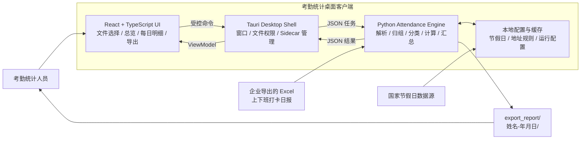
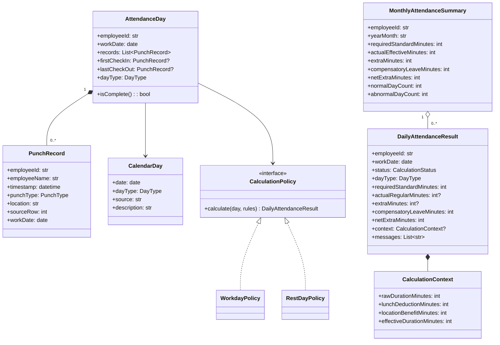
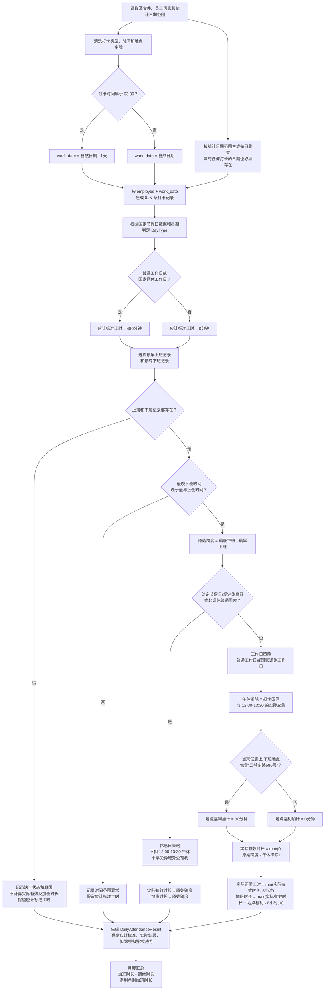

# 考勤统计工具软件设计说明

| 项目 | 内容 |
|---|---|
| 文档版本 | v1.8.0-draft |
| 文档状态 | 设计草案 |
| 更新日期 | 2026-07-15 |
| 需求来源 | `设计大纲.ipynb` |
| 适用阶段 | 需求澄清、架构设计、核心计算规则验证 |

## 1. 文档版本约定

本文件使用语义化方式维护设计版本：

- **主版本号**：核心架构、核心领域模型或主要计算口径发生不兼容变化。
- **次版本号**：增加业务规则、页面、模块或新的输出能力。
- **修订号**：文字澄清、图示修正、不改变业务结果的设计调整。
- `draft` 表示设计尚未完成业务验收。

后续修改直接更新本文件中的版本号，并在“版本记录”中保留变更摘要；历史内容由 Git 追踪，不为每个版本复制一份独立文件。

---

## 2. 设计目标

考勤统计工具用于读取企业导出的 Excel 打卡日报，根据工作日、节假日、跨日、午休和地点福利等规则计算员工每日及月度考勤数据，并提供现代化客户端进行结果总览、逐日追溯和 Excel 导出。

核心目标：

1. 计算结果正确、可测试、可解释。
2. 用户可以看到汇总结果，也可以追溯每天的原始记录和扣除过程。
3. UI、Excel 格式、节假日数据源与计算规则相互解耦。
4. 最终可生成 Apple Silicon macOS 安装包和 Windows 安装包。
5. 安装包阶段后置，先完成业务规则和计算结果验证。

非目标：

- 当前阶段不实现云端多用户系统。
- 当前阶段不引入数据库服务器。
- 当前阶段不处理考勤审批、薪资核算或人事权限系统。
- 当前阶段不制作正式安装包。

---

## 3. 推荐技术架构

### 3.1 推荐方案

采用 **Tauri 桌面壳 + React/TypeScript 前端 + Python 计算 Sidecar** 的混合桌面架构。

| 层次 | 推荐技术 | 职责 |
|---|---|---|
| 桌面容器 | Tauri | 窗口、文件选择、进程调用、安装包和本地权限 |
| 客户端界面 | React + TypeScript | 现代化页面、统计卡片、表格、详情抽屉、状态管理 |
| UI 组件 | 成熟 React 组件库，实施时再选型 | 表格、日期选择、通知、进度、主题 |
| 计算引擎 | Python | Excel 解析、打卡归组、日期分类、规则计算、导出数据生成 |
| 桌面通信 | Tauri Command + Python Sidecar | 通过标准输入输出上的 JSON Lines 协议交换任务及结果 |
| 本地存储 | JSON/SQLite，按实际复杂度选择 | 节假日缓存、用户配置、最近文件和运行记录 |
| Excel 处理 | Python Excel 库，开发阶段选型 | 读取源报表、生成结果报表 |
| 测试 | pytest + 前端测试工具 | 核心规则单元测试、适配器测试和 UI 测试 |

### 3.2 选择原因

1. React/TypeScript 更容易实现现代化数据看板和复杂明细表格。
2. Python 继续承担考勤计算和 Excel 处理，符合当前项目环境，也便于快速编写规则测试。
3. Tauri 负责桌面能力，前端不直接访问任意本地文件或启动任意进程。
4. Python 计算引擎以独立 CLI 形式存在，既可被客户端调用，也可以脱离 UI 单独测试和批量运行。
5. 最终安装包内置 Python Sidecar，终端用户不需要安装 Python 或激活项目虚拟环境。

### 3.3 备选方案

| 方案 | 优点 | 主要不足 | 建议 |
|---|---|---|---|
| PySide6 + Python | 单语言、开发和调试简单 | 构建现代 Web 风格界面的成本较高 | 若 Tauri 打包风险过高可回退 |
| Electron + React | 桌面生态成熟、打包资料丰富 | 安装体积和运行内存通常更高 | 作为第二备选 |
| 纯 Tauri + Rust | 体积小、单一后端运行时 | Excel 与业务规则需要改用 Rust 实现 | 当前不优先 |
| Web 服务 + 浏览器 | 部署集中、多人使用方便 | 需要服务器、权限和数据安全设计 | 当前单机工具不采用 |

> 架构决策点：在业务计算原型验证完成后，先制作一个“React 页面调用 Python Sidecar”的最小技术验证，再正式铺开 UI，避免到安装包阶段才发现跨平台集成问题。

---

## 4. 系统上下文与容器设计



### 4.1 通信原则

Python Sidecar 提供两种兼容模式：命令行单次计算用于开发、测试和故障排查；桌面客户端使用应用生命周期内常驻的 `serve` 模式。`serve` 不监听 HTTP 端口，只通过父子进程的标准输入输出交换一行一个 JSON 的 JSON Lines 消息：

```text
attendance-engine serve

stdin:  {"requestId":1,"command":"calculate","inputPath":"/path/report.xlsx"}
stdout: {"requestId":1,"success":true,"days":[...]}
```

桌面端在 Tauri 启动阶段异步预热 Sidecar，计算请求串行进入同一进程。进程异常退出或通信损坏时清理连接，后续请求重新启动，不使用端口，也不开放任意命令执行能力。

选择常驻标准输入输出协议的理由：

- 避免 PyInstaller Python 运行时在每次点击“开始统计”时重复启动；
- 不占用本地端口，没有端口冲突、防火墙提示和 HTTP 攻击面；
- 请求和结果保持独立 JSON 消息，仍然容易追踪、测试和重试；
- Tauri 只启动安装包内固定路径的 Sidecar，安全边界明确。

发布构建使用 PyInstaller `--onedir`，将运行时文件作为 Tauri resource 一起安装。相比 `--onefile` 每次运行时解压，`--onedir` 将文件展开工作前移到安装阶段；配合应用启动预热，用户点击计算时只承担 Excel 解析、计算和导出耗时。

处理大量数据时，Sidecar 可通过标准输出发送结构化进度事件：

```json
{"event": "progress", "current": 30, "total": 100, "message": "正在计算每日考勤"}
```

---

## 5. 领域模型



### 5.1 核心枚举

```text
PunchType
├── CHECK_IN
└── CHECK_OUT

DayType
├── NORMAL_WORKDAY          普通工作日
├── MAKEUP_WORKDAY          国家规定的调休工作日
├── STATUTORY_HOLIDAY       国家法定节假日或规定休息日
├── ORDINARY_WEEKEND        非调休工作日的普通周六或周日
└── UNKNOWN                 无法判定，禁止静默猜测

CalculationStatus
├── SUCCESS
├── SKIPPED_MISSING_CHECK_IN
├── SKIPPED_MISSING_CHECK_OUT
├── SKIPPED_INVALID_TIME_RANGE
├── SKIPPED_UNKNOWN_DAY_TYPE
└── FAILED_DATA_VALIDATION
```

领域内部统一使用整数分钟计算，避免使用浮点小时导致 `7.999999` 一类精度问题；展示和 Excel 导出时再格式化为 `8小时30分钟` 或 `8.50小时`。

需要区分五个概念：

- `requiredStandardMinutes`：按照日期类型应计入月度的标准工时；工作日固定为 480 分钟，休息日为 0 分钟，与当天是否缺卡无关；
- `actualRegularMinutes`：打卡完整时，实际有效时长中不超过 480 分钟的部分；缺卡时为 `null`，表示无法计算而不是零工时；
- `extraMinutes`：由完整打卡记录计算出的加班时长；缺卡时为 `null`，汇总时按 0 处理；
- `compensatoryLeaveMinutes`：从“假勤申请”中的“调休假 N 小时”解析出的调休消耗；
- `netExtraMinutes`：净剩加班时长，计算公式为“加班时长 - 调休时长”，允许为负数。

---

## 6. 单日考勤计算流程



---

## 7. 规则优先级与计算口径

规则必须按以下顺序处理，避免不同规则相互覆盖。

### 7.1 工作日期归属

以凌晨 `03:00` 为工作日边界：

```python
if punch_time < 当天03:00:
    work_date = natural_date - 1 day
else:
    work_date = natural_date
```

例如：

```text
2026-07-13 09:00 上班
2026-07-14 02:00 下班
```

两条记录都归入 `2026-07-13` 工作日。

### 7.2 多次打卡

同一员工同一工作日存在多条记录时：

- 上班时间取所有上班记录中的最早时间；
- 下班时间取所有下班记录中的最晚时间；
- 地点福利检查当天全部上班和下班记录，不只检查被选中的首尾记录。

### 7.3 缺卡与月度标准工时

系统必须先根据统计日期范围生成完整的每日骨架，再把打卡记录挂载到相应日期，不能只为存在打卡记录的日期创建 `AttendanceDay`。因此，即使某个工作日完全没有打卡，也能被识别为缺卡日期。

- 缺少上班记录：不计算当天实际有效工时和加班/调休时长；
- 缺少下班记录：不计算当天实际有效工时和加班/调休时长；
- 普通工作日或国家调休工作日缺卡：仍向月度应计标准工时贡献 480 分钟；
- 节假日或非调休普通周末缺卡：向月度应计标准工时贡献 0 分钟；
- 缺卡日期必须进入每日明细和异常清单，显示日期、日期类型及缺卡原因；
- 缺卡时 `actualRegularMinutes` 和 `extraMinutes` 使用 `null` 表示“未计算”，UI 显示为“缺卡/未计算”，不能显示成正常的 0 小时。

### 7.4 日期类型判定优先级

建议使用以下优先级：

1. 国家节假日数据明确标记为休息或节假日：`STATUTORY_HOLIDAY`；
2. 国家节假日数据明确标记为调休工作日：`MAKEUP_WORKDAY`；
3. 非调休工作日的周六或周日：`ORDINARY_WEEKEND`；
4. 其他周一至周五日期：`NORMAL_WORKDAY`；
5. 无法判定：`UNKNOWN`，记录异常，不自行猜测。

国家节假日数据的明确标记优先于星期规则，因此国家调休周六或周日仍属于工作日。源 Excel 即使把普通周六或周日标记为工作日，也不能覆盖国家节假日数据和普通周末规则。

### 7.5 午休扣除

午休规则只适用于：

- `NORMAL_WORKDAY`；
- `MAKEUP_WORKDAY`。

扣除的是打卡区间与 `[12:00, 13:30]` 的实际重叠时间，而不是无条件扣除 90 分钟。

| 打卡区间 | 午休扣除 |
|---|---:|
| 09:00-11:30 | 0 分钟 |
| 09:00-12:30 | 30 分钟 |
| 12:30-18:00 | 60 分钟 |
| 09:00-18:00 | 90 分钟 |

节假日和非调休普通周六、周日不扣午休。

### 7.6 异地办公福利

地点匹配关键字：

```text
云岭东路586号
```

地点字段采用包含匹配，不要求完整地址完全相等：

```python
has_location_benefit = "云岭东路586号" in location
```

解析前应去除地点字段首尾空白；当前不进行拼音、同义地址或缺失字符的模糊匹配。

仅在工作日策略中生效：

- 普通工作日：可以享受；
- 国家调休工作日：按工作日处理，可以享受；
- 国家节假日或规定休息日：不享受；
- 非调休普通周六或周日：按节假日策略处理，不享受。

工作日当天任意一条上班或下班记录的地点字段包含 `云岭东路586号` 时，获得 30 分钟地点福利折算额度；一天最多加计一次。该额度不从实际有效工时中扣除，而是在计算加班时长时与实际有效工时相加。

### 7.7 应计标准工时、加班时长、调休时长与净剩加班时长

月度应计标准工时根据日期类型计算，不依赖当天打卡是否完整：

```text
普通工作日或国家调休工作日：应计标准工时 = 8小时
节假日或非调休普通周末：应计标准工时 = 0小时
```

打卡完整的工作日：

```text
实际有效时长 = max(0, 原始跨度 - 午休重叠)
实际正常工时 = min(实际有效时长, 8小时)
加班时长 = max(实际有效时长 + 地点福利折算额度 - 8小时, 0)
```

例如工作日实际有效时长恰好为 8 小时且命中指定地点时，实际有效工时仍为 8 小时，加班时长为 30 分钟；不得把福利额度计入午休或从实际有效工时中减去。

打卡完整的节假日或非调休普通周末：

```text
实际有效时长 = 原始跨度
实际正常工时 = 0
加班时长 = 实际有效时长
```

缺卡日期：

```text
应计标准工时 = 由日期类型决定的 8小时或0小时
实际有效时长 = 未计算
实际正常工时 = 未计算
加班时长 = 未计算
```

源报表“假勤申请”字段中出现“调休假 N 小时”时，将 N 小时解析为当天的 `compensatory_leave_minutes`。同一日期、同一申请文本可能同时出现在概况表和多条打卡明细中，解析器必须去重，不能重复扣除。

```text
单日净剩加班时长 = 当日加班时长（未计算时按0）- 当日调休时长
月度净剩加班时长 = 月度加班时长 - 月度调休时长
```

净剩加班时长允许为负数。例如某工作日没有实际打卡，但假勤申请标记调休 8 小时，则当天加班时长为“未计算”、调休时长为 8 小时、净剩加班时长为 -8 小时。基础加班仍来自实际有效时长超过 8 小时的部分；工作日命中地点福利时，再按上述折算公式计入 30 分钟。当前不存在固定的标准上下班时间窗口。

---

## 8. 模块边界

建议项目逐步演进为：

```text
Attendance_tool/
├── apps/
│   └── desktop/                       # Tauri + React 客户端
│       ├── src/
│       │   ├── pages/
│       │   ├── components/
│       │   ├── features/
│       │   ├── stores/
│       │   └── types/
│       └── src-tauri/
├── attendance_engine/                 # Python 计算引擎
│   ├── domain/
│   │   ├── models.py
│   │   ├── enums.py
│   │   ├── rules.py
│   │   ├── policies/
│   │   │   ├── workday.py
│   │   │   └── rest_day.py
│   │   └── services/
│   │       ├── work_date_resolver.py
│   │       ├── attendance_day_builder.py
│   │       └── attendance_calculator.py
│   ├── application/
│   │   ├── calculate_attendance.py
│   │   ├── generate_summary.py
│   │   └── export_report.py
│   ├── infrastructure/
│   │   ├── excel/
│   │   │   ├── reader.py
│   │   │   └── writer.py
│   │   ├── holidays/
│   │   │   ├── provider.py
│   │   │   └── cache.py
│   │   └── config/
│   ├── cli.py
│   └── schemas.py
├── tests/
│   ├── unit/
│   ├── integration/
│   ├── fixtures/
│   └── golden_files/
├── docs/
│   └── 考勤统计工具-软件设计说明.md
├── export_report/
├── pyproject.toml
└── README.md
```

### 8.1 依赖方向

```text
React UI
    ↓
Tauri Command
    ↓
Python Application Use Case
    ↓
Python Domain

Infrastructure Adapter ──实现──> Domain/Application 定义的接口
```

领域层禁止依赖：

- PySide6、React 或 Tauri；
- 具体 Excel 库；
- HTTP 请求库；
- 操作系统路径；
- UI 展示文案。

这样即使以后把 Tauri 换成 PySide6、Electron 或 Web 页面，核心考勤计算也不需要重写。

---

## 9. 客户端信息架构

### 9.1 主流程


### 9.2 页面布局建议

主窗口采用单窗口数据工作台，而不是多层弹窗：

```text
┌──────────────────────────────────────────────────────────────┐
│ 考勤统计    当前文件    统计月份                     设置    │
├──────────────────────────────────────────────────────────────┤
│ [选择文件] [开始计算] [导出结果]       处理状态 / 进度       │
├──────────────┬──────────────┬──────────────┬────────────────┤
│ 应计标准工时 │ 实际有效工时 │ 加班 │ 调休 │ 净剩加班 │ 异常天数 │
├──────────────────────────────────────────────────────────────┤
│ 筛选：全部 / 正常 / 异常 / 工作日 / 节假日                  │
├──────────────────────────────────────────────────────────────┤
│ 每日明细表                                                   │
│ 日期 | 类型 | 上班 | 下班 | 午休扣除 | 福利加计 | 结果      │
├──────────────────────────────────────────────────────────────┤
│ 选中日期详情：全部打卡记录、计算公式、规则说明               │
└──────────────────────────────────────────────────────────────┘
```

交互原则：

- 汇总数字只负责快速判断，不替代每日明细；
- 六个汇总卡片支持点击钻取，展示工时构成、加班来源、调休申请、净剩余额轨迹和异常日期；
- 异常天数使用明确的状态标签和原因，不只依赖颜色；
- 每天结果都可以展开查看“原始跨度 → 午休扣除 → 实际有效工时 → 福利加计 → 加班 → 调休 → 净剩加班”；
- 页面右上角提供“？”帮助抽屉，以快速开始、结果说明、计算规则和常见问题四个折叠章节呈现用户文档；
- 计算完成后先展示结果，由用户主动确认导出；
- 原始 Excel 不在原位置覆盖写入。

---

## 10. 输入、输出与文件管理

### 10.1 输入

第一阶段支持单个 Excel 文件，且一个文件原则上只包含当前员工本人的考勤数据。Excel 适配器负责把供应商字段转换为统一 `PunchRecord`，领域层不认识源表列名。若校验发现多个不同员工编号或姓名，默认中止计算并提示用户检查源文件，不静默合并或拆分。

需要在实现前确认：

- 工作表名称；
- 表头所在行；
- 姓名或员工编号字段；
- 上班/下班类型字段；
- 打卡时间格式；
- 打卡地点字段；
- Excel 中日期类型字段是否可信；
- 合并单元格、空行和重复行的处理方式。

### 10.2 输出目录

按照需求写入：

```text
export_report/<姓名>-<统计日期YYYYMMDD>/
```

目录中的日期使用统计日期，不使用实际执行导出的日期。对于包含日期区间的日报，统计日期取报表统计截止日期。例如统计范围为 `2026-07-01` 至 `2026-07-13`，目录为：

```text
export_report/<姓名>-20260713/
```

建议文件名：

```text
<姓名>-<统计开始日期>-<统计结束日期>-考勤统计.xlsx
```

若同一天重复导出，禁止静默覆盖。可采用：

```text
<姓名>-<统计开始日期>-<统计结束日期>-考勤统计-<HHmmss>.xlsx
```

或者由客户端明确询问是否覆盖。

### 10.3 Excel 内容

建议至少包含四个工作表：

1. `月度汇总`：应计标准工时、实际有效工时、加班时长、调休时长、净剩加班时长和异常天数；
2. `每日明细`：每天首尾打卡、扣除项、加班、调休、净剩加班和状态；
3. `原始打卡记录`：用于审计打卡数据；
4. `原始调休记录`：记录解析到的调休申请、时长、来源工作表和源表行号。

---

## 11. 节假日数据设计

当前实现使用三层节假日来源，优先级和失败策略如下：

1. **24 小时内的本地缓存**：直接使用，避免每次计算都等待网络；
2. **在线年度数据**：缓存不存在或超过 24 小时时，从 `holiday-cn` 的 Fastly JSDelivr、JSDelivr 和 GitHub Raw 三个 HTTPS 地址并发获取，采用第一个通过校验的结果；
3. **过期缓存**：在线更新失败但已有历史缓存时继续离线使用，并在 UI 标记为“离线缓存”；
4. **内置 `chinese-calendar`**：在线和缓存都不存在时，仅对内置库明确支持的年份兜底；
5. **安全失败**：目标年份既没有在线/缓存数据，也不在内置库支持范围时停止计算并提示检查网络，不允许按普通星期规则猜测国家调休。

`holiday-cn` 自动抓取国务院公告，年度 JSON 记录 `papers` 公告地址以及 `days[].isOffDay`。客户端只接受年份匹配、日期和布尔字段有效、且至少包含一个 `gov.cn` 公告来源的非空数据。在线地址：

```text
https://fastly.jsdelivr.net/gh/NateScarlet/holiday-cn@master/{year}.json
https://cdn.jsdelivr.net/gh/NateScarlet/holiday-cn@master/{year}.json
https://raw.githubusercontent.com/NateScarlet/holiday-cn/master/{year}.json
```

Sidecar 启动时后台预取当前年份和下一年份。计算跨到 12 月时额外检查下一年度文件，因为下一年度国务院文件可能包含对上一年 12 月日期的安排。下载内容限制为 1 MiB，经过结构校验后使用临时文件加原子替换写入 Tauri 用户缓存目录，避免进程中断留下半份缓存。

节假日数据属于计算依据，导出结果应记录：

- 数据来源；
- 获取时间；
- 使用年份；
- 是否来自缓存。

---

## 12. 测试设计

核心规则必须先通过单元测试，再接入 UI。

### 12.1 最低测试矩阵

| 场景 | 预期结果 |
|---|---|
| 工作日 09:00-18:30 | 扣完整午休，计算有效时长 |
| 工作日 09:00-12:30 | 只扣 30 分钟午休 |
| 工作日 12:30-18:00 | 只扣 60 分钟午休 |
| 工作日有效工时 8 小时且地点包含“云岭东路586号” | 实际有效工时保持 8 小时，加班/调休加计 30 分钟 |
| 节假日命中指定地点 | 不扣午休，也不扣地点福利 |
| 普通周六且 Excel 标记工作日 | 按休息日规则，全算加班/调休时长 |
| 普通周日且 Excel 标记工作日 | 按休息日规则，全算加班/调休时长 |
| 国家调休周日 | 按工作日规则，可扣午休并加计地点福利 |
| 下班时间在次日 02:00 | 归入上一工作日 |
| 打卡时间正好在 03:00 | 归入当天 |
| 多次上下班打卡 | 取最早上班和最晚下班 |
| 工作日只有上班记录 | 应计标准工时增加 8 小时；实际和加班/调休未计算 |
| 工作日只有下班记录 | 应计标准工时增加 8 小时；实际和加班/调休未计算 |
| 工作日完全没有打卡 | 日期仍存在，应计标准工时增加 8 小时并记录缺卡 |
| 工作日没有打卡但假勤申请为调休 8 小时 | 加班时长未计算；调休 8 小时；净剩加班 -8 小时 |
| 休息日缺卡或没有打卡 | 应计标准工时增加 0 小时；实际和加班/调休未计算 |
| 午休扣除后小于零 | 有效时长截断为零 |
| 节假日数据未知 | 不计算并提示数据异常 |
| 在线数据可用 | 使用在线年度调休/休息日并写入缓存 |
| 24 小时内缓存可用 | 不发起网络请求，直接计算 |
| 在线更新失败但存在旧缓存 | 使用离线缓存并展示来源 |
| 未来年份无在线、缓存和内置数据 | 停止计算，禁止猜测调休安排 |

### 12.2 测试分层

- **领域单元测试**：不读取 Excel、不访问网络，直接构造对象验证公式。
- **Excel 适配器测试**：使用脱敏的小型固定样本。
- **黄金文件测试**：固定输入 Excel 对应固定输出 JSON/Excel 关键单元格。
- **端到端测试**：客户端选择文件、计算、查看结果、导出。
- **跨平台构建测试**：业务验收后再加入 macOS arm64 和 Windows 构建流水线。

---

## 13. 打包与平台说明

打包工作放在业务规则和结果验收之后。

计划目标：

- macOS：Apple Silicon `arm64` 应用和 DMG 构建脚本；
- Windows：提供标准 64 位 `x86_64/x64/AMD64` EXE 或安装程序；
- 不要求支持 32 位 `x86/ia32/i686` Windows。

### 13.1 Windows 架构结论

本项目中的“x86 Windows”已确认是通常使用的 64 位 PC 架构，正式构建目标统一表述为：

```text
x86_64 / x64 / AMD64
```

不构建 32 位 `x86/ia32/i686` 版本，避免在文档、脚本和发布文件名中继续使用含义不明确的单独 `x86` 表述。

---

## 14. 已确认的业务决策

1. `extra_minutes` 继续表示由打卡计算出的加班时长；假勤申请中的调休使用 `compensatory_leave_minutes` 单独记录；`net_extra_minutes = extra_minutes - compensatory_leave_minutes`。
2. 基础“标准时间以外”指有效工作时长超过 8 小时的部分，不存在固定上下班时间窗口；命中地点福利时，30 分钟折算额度额外参与加班计算。
3. 非国家调休工作日的普通周六、周日都按照休息日规则处理。
4. Windows 发布目标为 64 位 `x86_64/x64/AMD64`。
5. 输出目录使用统计日期；区间报表使用统计截止日期。
6. 一个源 Excel 原则上只包含当前员工本人的数据；检测到多个员工时中止并提示。
7. 缺卡日期若属于工作日，仍计入 8 小时月度应计标准工时；若属于休息日，则不计入月度应计标准工时。缺卡日期不计算实际有效工时和加班时长，但仍可从假勤申请中统计调休并参与净剩加班。
8. 地点字段只要包含 `云岭东路586号` 关键字即可命中异地办公福利，不要求完整地址相等。
9. 地点福利不属于休息时间，也不从实际有效工时中扣除；工作日实际有效工时与 30 分钟福利额度相加后，超过 8 小时的部分计入加班。

---

## 15. 分阶段实施建议

### Phase 1：数据勘察和规则固化

- 分析实际 Excel 表结构；
- 将源表映射为 `PunchRecord`；
- 将已确认的业务规则转换为可执行测试用例；
- 建立脱敏测试样本。

### Phase 2：纯 Python 计算引擎

- 实现工作日期归属；
- 实现日期分类；
- 实现工作日和休息日策略；
- 建立完整单元测试；
- 先输出 JSON 结果验证业务口径。

### Phase 3：Excel 输出

- 生成月度汇总、每日明细和原始记录；
- 验证格式和计算结果；
- 确认目录及覆盖策略。

### Phase 4：现代桌面客户端

- 建立 Tauri + React 工程；
- 完成文件选择、进度、汇总、明细和导出；
- 集成 Python Sidecar；
- 完成最小跨平台技术验证。

### Phase 5：发布

- Apple Silicon macOS 构建；
- DMG 自动化脚本；
- Windows x64/AMD64 构建；
- 最后处理签名、安装提示和发布说明。

---

## 16. 当前实现状态

截至 `v1.8.0-draft`，已完成：

- Python 考勤计算引擎、源 Excel 打卡与调休申请解析，以及四工作表结果导出；
- 国家节假日、调休工作日和普通周末分类；
- 凌晨 03:00 归属、缺卡、午休、地点福利、加班、调休和净剩加班计算；
- React/TypeScript 现代客户端和 Tauri 桌面容器；
- 面向用户的内置帮助抽屉、计算图示和 FAQ；
- 汇总卡片详情钻取、节假日来源说明、调休审计、净剩加班逐日余额和每日明细切换动效；
- Python PyInstaller Sidecar 与 Tauri Command 集成；
- Sidecar `--onedir` 资源打包、应用启动预热和常驻 JSON Lines 通信；
- Apple Silicon arm64 `.app` 和经过完整性校验的 unsigned DMG；
- 其他 Apple Silicon Mac 可复现构建脚本；
- Windows x64 Sidecar、NSIS EXE 构建脚本和 GitHub Actions 工作流。

当前 macOS 产物：

```text
release/考勤统计_0.2.0_aarch64_unsigned.dmg
```

该 DMG 使用 ad-hoc 签名保证本地 bundle 完整性，但没有 Apple Developer ID 签名和公证，不能视为可公开发布的正式签名软件。Windows EXE 必须在 Windows x64 或 Windows CI 中原生生成，不能直接使用当前 macOS arm64 构建产物代替。

---

## 17. 版本记录

| 版本 | 日期 | 状态 | 变更内容 |
|---|---|---|---|
| v1.8.0-draft | 2026-07-15 | 当前版本 | 新增面向用户的内置帮助中心；汇总卡片、节假日来源和每日明细支持动效与详情钻取，并补充调休申请审计和净剩加班逐日余额视图。 |
| v1.7.0-draft | 2026-07-15 | 历史版本 | 软件升级至 0.2.0；从假勤申请解析并去重调休时长，新增净剩加班时长；Windows 文件选择改用 UTF-16 路径传递；同步更新本地构建脚本与 GitHub Actions。 |
| v1.6.0-draft | 2026-07-15 | 历史版本 | 增加在线节假日业务逻辑：多地址并发获取国务院公告衍生年度数据、24 小时原子缓存、Sidecar 启动预取、离线及内置库兜底，并在 UI/Excel 展示数据来源。 |
| v1.5.0-draft | 2026-07-15 | 历史版本 | 优化计算响应：Sidecar 从每次启动的 onefile CLI 调整为 onedir 资源包、应用启动预热和常驻 JSON Lines 进程，避免重复解压 Python 运行时。 |
| v1.4.0-draft | 2026-07-15 | 历史版本 | 修正地点福利口径：福利不再从实际有效工时扣除，而是参与加班/调休折算；Windows 客户端内置 Noto Sans SC，并固定 Python Sidecar 使用 UTF-8 协议。 |
| v1.3.0-draft | 2026-07-13 | 历史版本 | 完成 Python 计算引擎、React/Tauri 客户端、Excel 结果导出、macOS arm64 unsigned DMG、可复现 Mac 构建脚本、Windows x64 构建脚本和 CI 配置。 |
| v1.2.0-draft | 2026-07-13 | 历史版本 | 明确缺卡日期的月度标准工时规则；拆分应计标准工时、实际有效工时和加班/调休时长；按完整日期范围生成每日骨架；地点福利改为包含“云岭东路586号”关键字匹配。 |
| v1.1.0-draft | 2026-07-13 | 历史版本 | 固化业务确认结果：加班与调休合并为同一字段；普通周六、周日均按休息日处理；超过 8 小时才属于标准时间以外；Windows 目标为 x64/AMD64；目录使用统计截止日期；源 Excel 限定为单员工。 |
| v1.0.0-draft | 2026-07-13 | 历史版本 | 首次建立软件设计文档；采用 UI 与 Python 领域引擎解耦设计；推荐 Tauri + React + Python Sidecar；补充节假日不享受异地办公福利；加入领域模型、计算流程、测试和分阶段实施方案。 |
